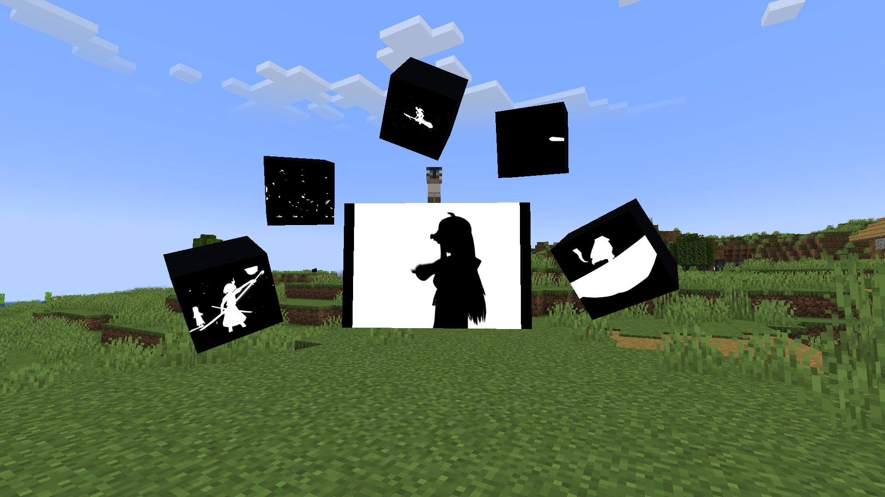
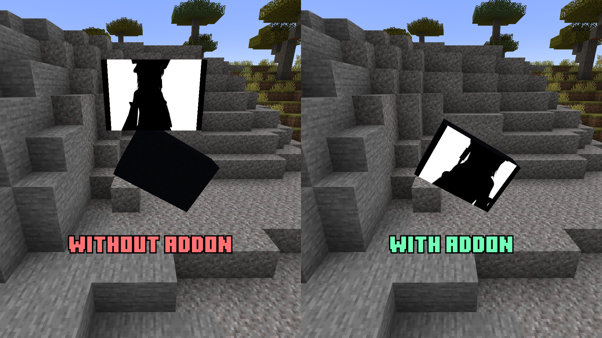
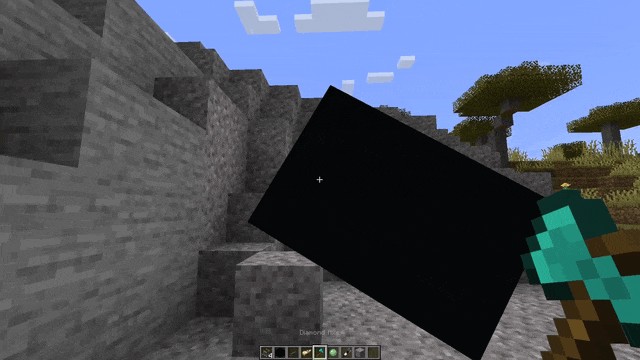
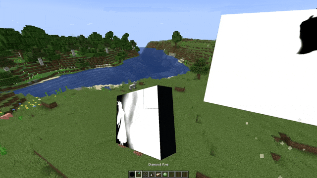
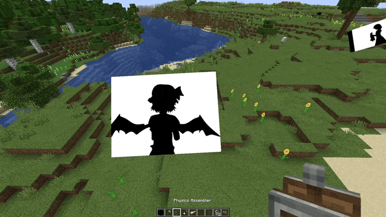

<a href="https://modrinth.com/mod/dreamdisplays-sable">Modrinth</a>
|
<a href="https://www.curseforge.com/minecraft/mc-mods/dreamdisplays-sable">CurseForge</a>
|
<a href="https://github.com/apehum/dreamdisplays-sable">GitHub</a>

# Dream Displays: Sable
Addon for [Dream Displays](https://modrinth.com/plugin/dreamdisplays) that makes displays work in [Sable](https://modrinth.com/mod/sable) sub-levels.

Dream Displays pins display to fixed world coordinates,
while Sable moves blocks out of the world into a sub-level with its own local coordinates.
So creating a sub-level around a display will make that display float in space with completely broken interactions.

# Features
- Rendering and interaction use the sub-level's current position, rotation and scale, so display stays in place and stays interactable while the sub-level is moving.
- Sound is positioned at the display's actual place on the sub-level instead of where it was created.
- Creating a display in an existing sub-level attaches it to that sub-level.
- Assembling a sub-level around a display attaches that display to the new sub-level.
- Merging and splitting keep displays attached to whichever sub-level their blocks ended up in.
- Disassembling returns the display to the world at the sub-level's final location, so it doesn't stay floating at the position it was created.

# Usage
There's no additional setup required, you just need to create a display in sub-level or assemble sub-level with existing display on it.

*[Create Aeronautics](https://modrinth.com/mod/create-aeronautics) is used for showcases, but it's not required for the addon to work*
